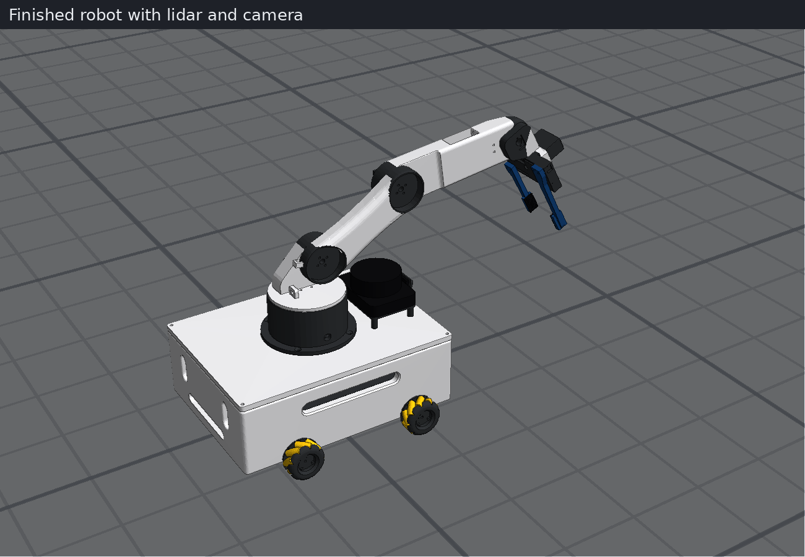

# MECHAMINDS mobile manipulator

A mecanum-wheel mobile base with a 4-DOF arm and gripper, a YDLIDAR X2 and a base camera, for ROS 2 Humble and Gazebo.
The same control software drives the simulation and the real robot, and a digital twin mirrors the real robot in Gazebo.

Designed by Subhani.



**Status:** tested in simulation, and the firmware against a simulated serial link. It has not been run on real hardware yet.

## Setup

Needs Ubuntu 22.04, ROS 2 Humble, Gazebo, and `gz_ros2_control` built in `~/gz_ros2_control_ws`.

```bash
source /opt/ros/humble/setup.bash
source ~/gz_ros2_control_ws/install/setup.bash
cd ~/MOBILE_ROBOT/ros2_ws
colcon build --symlink-install
source install/setup.bash
```

Run the three `source` lines in every new terminal, using `~/MOBILE_ROBOT/ros2_ws/install/setup.bash` for the last one.

## Run the simulation

```bash
ros2 launch amr_gazebo sim.launch.py
```

This opens Gazebo and RViz with SLAM and Nav2. Useful options: `gui:=false`, `rviz:=false`, `nav:=false`, `joy:=true`, `world:=<file.sdf>`.

To try the pick-and-place test world:

```bash
ros2 launch amr_gazebo sim.launch.py world:=$HOME/MOBILE_ROBOT/tools/tests/arena_inspect.sdf
ros2 run amr_control mission transfer 1.8 0 0 -1.5 0 3.14159 red
```

If Gazebo opens black or controllers don't start, a previous Gazebo may still be running. Close every sim terminal and launch again; each launch also clears this project's leftover Gazebo servers.

Stow the arm with `n` before mapping or driving a long way, so the lidar doesn't see it. Missions do this themselves.

## Drive it

Keyboard, in its own terminal: `ros2 run amr_control keyboard_teleop`

| Keys | Action |
|---|---|
| Arrow keys | Up and down drive forward and backward, left and right strafe |
| `i` `,` `j` `l` `u` `o` `m` `.` | Drive and turn |
| Shift + those keys | Strafe |
| `k` or space | Stop |
| `a`/`z`, `s`/`x`, `d`/`c`, `f`/`v` | Waist, shoulder, elbow, wrist |
| `g` / `b` | Gripper open / close |
| `h`, `n`, `r` | Home, stow, reach poses |
| `-` / `=` | Slower / faster |
| `1`, `2`, `0` | MANUAL, AUTO, STOP |
| `p` / `t` | Pick the object in front / place it |

Click the teleop terminal first, because keys only reach the window in focus. The robot only obeys drive and arm keys in MANUAL, and the teleop prints the current mode. If it says a key was ignored, press `1`.

Joystick (Xbox layout), with `joy:=true`:

| Control | Action |
|---|---|
| Hold LB | Left stick drives and strafes, right stick X turns |
| Hold RB | Left X waist, left Y shoulder, right Y elbow, right X wrist |
| LT / RT | Gripper open / close |
| A, B, X | MANUAL, AUTO, STOP |
| Y | Pick the object in front |
| D-pad | Up home, down stow, left reach, right place |

## Modes and missions

- **MANUAL:** keyboard and joystick drive the robot.
- **AUTO:** missions drive the robot. In RViz, select AUTO and use 2D Goal Pose: it fetches when empty and delivers when carrying, and stays in AUTO for the next goal.
- **STOP:** holds zero velocity until you select another mode.

A mission sent by command returns to MANUAL when it ends.

```bash
ros2 run amr_control mission pick red
ros2 run amr_control mission place
ros2 run amr_control mission go 1.0 0.5 0
ros2 run amr_control mission fetch 1.5 0.5 0 red
ros2 run amr_control mission deliver -1.0 0 3.14
ros2 run amr_control mission cancel
```

## Real robot and digital twin

Wiring for each board is in [docs/WIRING.md](docs/WIRING.md).

```bash
# Uno, ESP32 or UNO Q connected to the Pi or laptop
ros2 launch amr_control real.launch.py backend:=serial port:=/dev/ttyACM0 lidar:=true camera:=true
# Pi driving everything itself
ros2 launch amr_control real.launch.py backend:=pi_gpio
# No hardware
ros2 launch amr_control real.launch.py backend:=mock
```

Digital twin, with the robot and laptop on the same network and `ROS_DOMAIN_ID`:

```bash
ros2 launch amr_control real.launch.py backend:=serial lidar:=true camera:=true   # on the robot
ros2 launch amr_gazebo twin.launch.py robot:=false                                # on the laptop
ros2 topic echo /twin/status                                                      # tracking error
```

To try the twin with no hardware: `ros2 launch amr_gazebo twin.launch.py backend:=mock`

## Change the model

| To change | Edit | Then run |
|---|---|---|
| Colours | `COLOR` in `tools/cad_to_urdf.py`, plus wheel and mount colours in `amr.urdf.xacro` | `python3 -I tools/cad_to_urdf.py` |
| Front text, mounts | `tools/make_mounts.py` | `python3 tools/make_mounts.py` |
| Motor and servo pins | `firmware/amr_firmware/config.h` | Upload the sketch again |
| Speeds, joystick mapping | `ros2_ws/src/amr_control/config/robot.yaml` | Restart the launch |

After editing a URDF source, run `colcon build --symlink-install` in `ros2_ws`.

## Project layout

| Folder | Contents |
|---|---|
| `ros2_ws/src/amr_description` | URDF and meshes |
| `ros2_ws/src/amr_gazebo` | Simulation and twin launch files |
| `ros2_ws/src/amr_control` | Teleop, missions, navigation, hardware bridge |
| `firmware/` | Arduino sketch for Uno, ESP32 and UNO Q, and its tests |
| `tools/` | CAD to URDF, renders, wiring diagrams, tests in `tools/tests` |
| `hardware/` | [Gripper STL files and build guide](hardware/README.md) |
| `docs/` | [Wiring](docs/WIRING.md) and [CAD dimension check](docs/DIMENSIONS.md) |
| `images/` | `robot_*` and `pose_*` renders, `sim_*` simulation captures, `wiring_*` diagrams |

## Tests

With a simulation running (`nav:=false x:=-0.5` for teleop), from `tools/tests`:

```bash
python3 test_teleop.py      # keyboard and joystick
python3 test_motion.py      # base, arm and lidar
python3 test_goal_pose.py   # RViz goal flow, needs the arena_inspect world with nav
python3 test_twin.py        # needs twin.launch.py
```

Firmware, from `firmware/test`:

```bash
g++ -std=c++17 -I. -I../amr_firmware -x c++ sil_main.cpp -o /tmp/fw_sil -lm
python3 run_sil.py /tmp/fw_sil /tmp/fw.log
```
